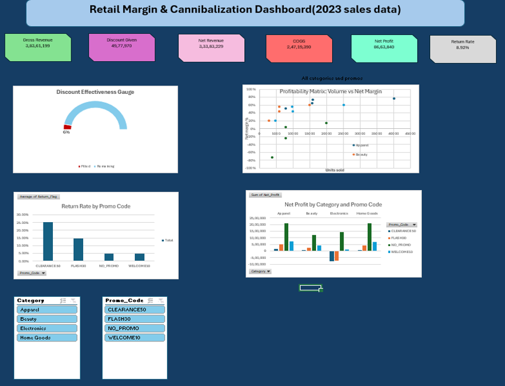

# Retail E-Commerce Dynamic Margin & Cannibalization Analyzer

An interactive Excel dashboard that shows the **true profit impact of discounts** on 200,000 e-commerce transactions, separating gross revenue from net profit after discount and cost of goods sold (COGS).

## Problem Statement
An online retailer runs aggressive flash sales that raise top-line revenue but reduce net profit. It suspects that heavy discounts cannibalize full-price sales. Existing reports show only gross revenue and volume, which hides the real loss on each discounted sale, and comparing promotions manually is slow and error-prone.

This project builds a dashboard that separates gross revenue from net profit, so the pricing team can replace broad flash sales with targeted, data-driven promotions.

## Objectives
- Separate gross revenue from net profit after discount and COGS
- Build a Profitability Matrix (sales volume vs. net margin)
- Check whether a 30% discount (FLASH30) produced enough volume to offset the lost margin
- Find out whether heavily discounted items are returned more often
- Identify which categories can survive heavy discounting

## Dataset
- 200,000 transactions, 1 Jan – 31 Dec 2023, 10 columns (one row per unit sold)
- Columns: Transaction_ID, Date, Category, Base_Cost, Retail_Price, Promo_Code, Discount_Pct, Final_Sale_Price, Net_Profit, Returned
- Categories: Apparel, Beauty, Electronics, Home Goods
- Promo codes: NO_PROMO (0%), WELCOME10 (10%), FLASH30 (30%), CLEARANCE50 (50%)
- Simulated dataset provided with an academic case study. No missing values or duplicate IDs.

## Tools
Microsoft Excel: Tables, PivotTables, PivotCharts, Slicers, formulas (IF, SUM, AVERAGE), KPI cards

## Approach
`CSV → Excel Table → Pivot Tables → Pivot Charts & Slicers → Dashboard`

1. Loaded the CSV into an Excel Table and checked blanks, duplicate IDs and promo-to-discount mapping
2. Added two derived columns: `Margin_% = Net_Profit ÷ Final_Sale_Price` and `Return_Flag = 1 if Returned = "Yes", else 0`
3. Built 4 PivotTables (category × promo, promo-wise volume vs. profit, return rate, category profit)
4. Built the charts, 6 KPI cards and Category / Promo_Code slicers, and reconciled pivot totals with the KPIs

**Discount Effectiveness Gauge:** required volume = avg profit per sale at NO_PROMO ÷ avg profit per sale at FLASH30; actual volume = FLASH30 units ÷ NO_PROMO units.

## Dashboard Contents
| Visual | What it answers |
|---|---|
| 6 KPI cards | Gross revenue, discount given, net revenue, COGS, net profit, return rate |
| Profitability Matrix (scatter) | Which category + promo combinations sell well *and* earn margin |
| Discount Effectiveness Gauge | Did FLASH30 bring enough extra volume to pay for itself? |
| Return Rate by Promo Code | Do bigger discounts cause more returns? |
| Net Profit by Category & Promo | Which categories survive heavy discounting? |
| Slicers | Filter everything by Category and Promo_Code |

## Key Results
| KPI | Value |
|---|---|
| Gross Revenue | 38.36M |
| Discount Given | 4.98M |
| Net Revenue | 33.38M |
| COGS | 24.72M |
| **Net Profit** | **8.66M** |
| Return Rate | 8.92% |

| Promo | Avg profit per sale | Return rate | Total net profit |
|---|---|---|---|
| NO_PROMO (0%) | 68.16 | 4.93% | 6.84M |
| WELCOME10 (10%) | 49.22 | 5.02% | 1.96M |
| FLASH30 (30%) | 10.43 | 14.75% | 0.42M |
| CLEARANCE50 (50%) | -27.55 | 25.10% | -0.55M |

## Conclusion
- **Revenue is not profit.** Electronics earned the highest revenue (18.93M) but only 8,584 in net profit.
- **Big discounts did not pay for themselves.** FLASH30 reached only **6%** of the volume it needed to match full-price profit, and NO_PROMO had the highest unit sales in every category.
- **Bigger discount, more returns.** Return rate rises from 4.93% (full price) to 14.75% (30% off) and 25.10% (50% off).
- **Electronics cannot survive heavy discounts.** Average margin is -24% under FLASH30 and -74% under CLEARANCE50.
- **Other categories stay profitable.** Apparel, Home Goods and Beauty make a profit under every promo.

**Recommendation:** Stop broad flash sales, avoid heavy discounts on Electronics, and use small targeted promos such as WELCOME10.

## Limitations
- No product ID or quantity, so the matrix uses Category × Promo_Code instead of individual products
- `Net_Profit` does not include the cost of returns, so real profit on heavily discounted items is lower than shown
- There is no pre-sale baseline, so cannibalization is *suggested*, not proved

## Future Work
- Include return costs in net profit
- Add a Python / ML extension (pandas, scikit-learn) to predict returns and order-level profitability
- Rebuild the dashboard in Power BI or Tableau

## Files
- `Retail_Margin_Cannibalization` CSV: full dataset (200,000 rows)
- `dashboard.png`: dashboard screenshot
- [Open the Excel dashboard](https://1drv.ms/x/c/299d1f24a3b7e74e/IQAnly3rLSQ_SoriDDTzvqJhAeOEOVWVu866nLqXFhg-PjU?e=BA1vGI)

## Author
**Shristi Pal**, MCA (AI & ML) · [GitHub](https://github.com/shristi-dell)
